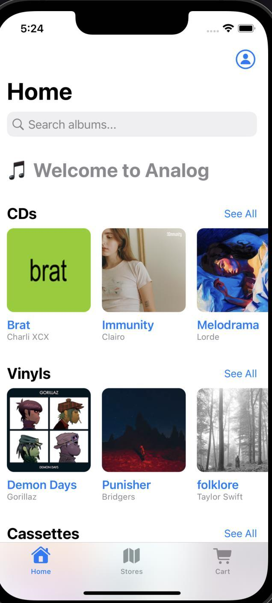
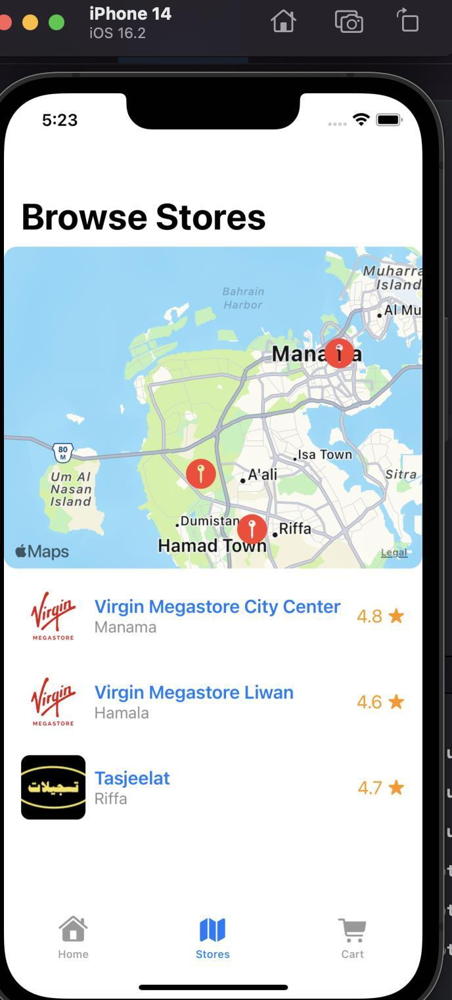
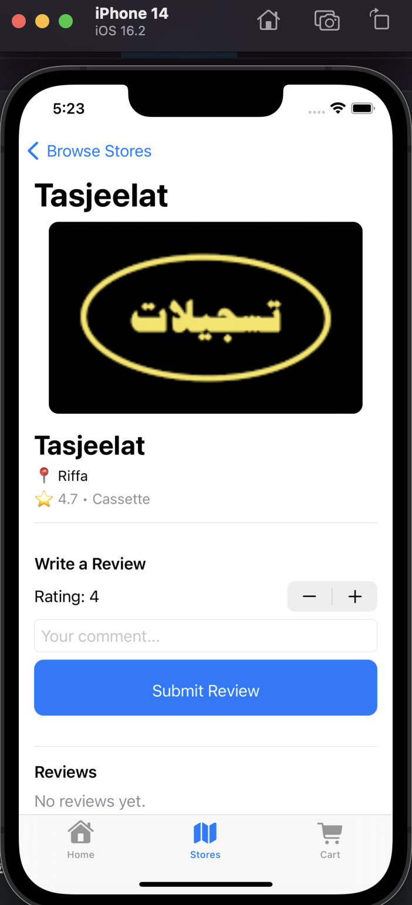
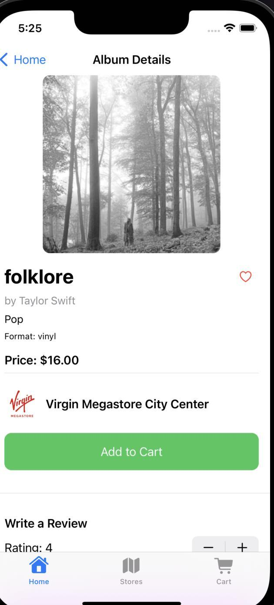
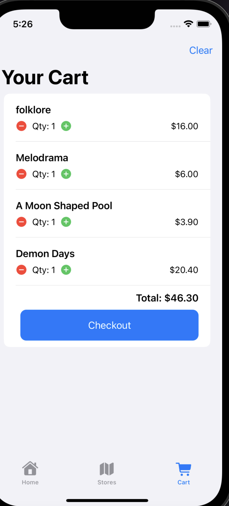
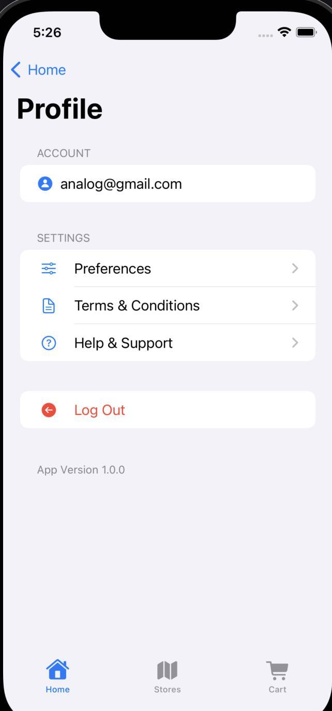

# 🎵 Analog – Online Music Store

**Analog** is an iOS app designed for music lovers to explore and purchase physical music formats such as CDs, vinyls, and cassettes. Built using SwiftUI and powered by Firebase, the app offers real-time browsing, store discovery in Bahrain, and seamless user interaction through a modern interface.

## 📱 Features

- 🔐 Firebase-backed Authentication (Login/Signup)
- 📦 Shopping Cart with Persistent User Orders
- 🧭 Map View for Browsing Physical Stores in Bahrain
- 💬 User Reviews on Albums and Stores
- 🧠 Favorites & Search Features
- 🎯 Browse by Genre and Format (CD / Vinyl / Cassette)
- 📍 Location-aware Store Recommendations
- ✨ Featured and Trending Albums Section

---
## 📸 Screenshots

### Browse Music & Discover Stores

  
  
  

### Album Details & Shopping Cart

  
  

### Profile & Login

  
  

---

## 🛠️ Tech Stack

- **Frontend:** SwiftUI
- **Backend:** Firebase (Firestore + FirebaseAuth)
- **Map Integration:** MapKit + CoreLocation
- **Development Environment:** Xcode 15

### 🔗 External Dependencies

- [Firebase SDKs (via Swift Package Manager)](https://firebase.google.com/docs/ios/setup)
- [MapKit](https://developer.apple.com/documentation/mapkit)

---

## 🧩 App Architecture

- **MVVM (Model-View-ViewModel) Pattern**
- **Modular Views** for album details, cart, store listings, and authentication
- **Real-Time Firestore Sync** for albums, orders, and reviews

### 🔍 Core Models
- `Album.swift`
- `Store.swift`
- `CartItem.swift`
- `Order.swift`
- `Review.swift`

### 📦 Core ViewModels
- `AuthViewModel.swift`
- `CartManager.swift`
- `OrderManager.swift`
- `StoreListViewModel.swift`
- `ReviewManager.swift`

---

**Zain Mayoof**  
AUBH – Mobile Programming Final Project  
---

